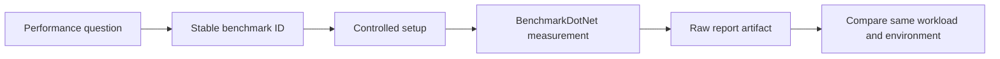

<p align="center">
  <a href="https://github.com/TrentBest/TheSingularityWorkshop.Visualize">
    
  </a>
</p>

# TheSingularityWorkshop.Benchmarks.DataWarehouse

[](https://github.com/TrentBest/TheSingularityWorkshop.Benchmarks.DataWarehouse/actions/workflows/benchmark.yml)
[](LICENSE)
[](https://github.com/TrentBest/TheSingularityWorkshop.Benchmarks.DataWarehouse/commits/development)

**The performance laboratory for the Workshop's low-level DataWarehouse.**

## 00 Identity

This repository tests the low-level [DataWarehouse](https://github.com/TrentBest/TheSingularityWorkshop.DataWarehouse) reconstruction. It is deliberately separate from the higher-level AEC-facing [SingularityWarehouse](https://github.com/TrentBest/SingularityWarehouse).

Its job is to make performance claims reproducible, workload-specific, and reviewable—not to produce a single flattering number.

## From question to evidence



*Conceptual measurement workflow. The current CI workflow runs the configured suite and uploads BenchmarkDotNet reports; it does not yet enforce performance thresholds or automatically validate cross-run comparability.*

## 01 What

The suite currently measures sequential reads, sequential writes, allocation/reclamation, handle-state queries, dirty-state transitions, and dirty-slot enumeration at controlled dirty densities. It uses BenchmarkDotNet in Release mode and preserves reports as workflow artifacts.

## 02 Why

A benchmark result is meaningful only when the operation, setup, baseline, environment, and measured work are clear. An array access is a useful lower-bound control, not a semantically identical replacement for a generation-checked handle and dirty-bit update.

Results describe the named workload on the recorded machine and runtime. They do not establish universal superiority.

## 03 How

- Keep benchmark IDs stable and specific so historical results remain attributable.
- Separate reads, writes, allocation, reclamation, dirty tracking, and scaling.
- Keep setup/teardown outside the measured operation unless setup cost is itself the subject.
- Use baselines only within comparable operation categories.
- Preserve reports; state the runtime, hardware, revision, and input scale when publishing conclusions.
- Treat performance regressions as evidence to investigate, not as unexplained noise or an automatic failure until thresholds are explicitly justified.

## 04 See it in a minute

Requires the .NET 8 SDK and both repositories checked out as sibling directories:

```text
workspace/
├── TheSingularityWorkshop.DataWarehouse/
└── TheSingularityWorkshop.Benchmarks.DataWarehouse/
```

Run the full suite:

```sh
dotnet run --project TheSingularityWorkshop.Benchmarks.DataWarehouse.csproj -c Release
```

Filter to a suite:

```sh
dotnet run --project TheSingularityWorkshop.Benchmarks.DataWarehouse.csproj -c Release -- --filter '*AccessReadBenchmarks*'
dotnet run --project TheSingularityWorkshop.Benchmarks.DataWarehouse.csproj -c Release -- --filter '*LifecycleBenchmarks*'\ndotnet run --project TheSingularityWorkshop.Benchmarks.DataWarehouse.csproj -c Release -- --filter '*TrackingQueryBenchmarks*'\ndotnet run --project TheSingularityWorkshop.Benchmarks.DataWarehouse.csproj -c Release -- --filter '*DirtyEnumerationBenchmarks*'
```

The project references the sibling source checkout intentionally while the library is under reconstruction. No NuGet package is published or required.

## 05 Available documentation and theory

- [Documentation inventory and diagram status](docs/DocumentationInventory.md)
- [Benchmark definitions](Benchmarks/)
- [Automated workflow](.github/workflows/benchmark.yml)
- [DataWarehouse implementation](https://github.com/TrentBest/TheSingularityWorkshop.DataWarehouse)
- [BenchmarkDotNet documentation](https://benchmarkdotnet.org/)

## Benchmark catalog

| Benchmark ID | What it measures | Current comparison |
|---|---|---|
| `AccessReadBenchmarks.ArrayRead` | Sequential record read control | Array, dictionary, DataShelf handle |
| `AccessWriteBenchmarks.ArrayWrite` | Sequential record write control | Array, dictionary, DataShelf handle plus dirty bit |
| `LifecycleBenchmarks.DataShelfAllocateAndFree` | Slot allocation and reclamation | DataShelf free-stack path versus dictionary add/remove |\n| `TrackingQueryBenchmarks.IsAliveValidHandle` | Valid-handle liveness query | DataShelf liveness bitmap and handle validation |\n| `TrackingQueryBenchmarks.IsDirtyCleanHandle` | Clean-handle dirty-state query | DataShelf dirty bitmap and handle validation |\n| `TrackingQueryBenchmarks.MarkCleanAndRedirty` | Clean/dirty transition pair | Repeated dirty-bit transition on a valid handle |\n| `DirtyEnumerationBenchmarks.CopyDirtySlots` | Dirty slot enumeration | 0%, 1%, 50%, and 100% dirty density, 65,536-slot shelf |

The access suite uses 65,536 pre-created records and cycles through them sequentially. Setup and teardown are outside the measured operations. Read and write comparisons use separate baselines.

## Planned coverage—not results

1. Capacity scaling: 1, 64, 1K, 64K, and million-slot shelves.
2. Random versus sequential access; hot versus cold working sets.
3. Allocation/free churn and fragmentation behavior.
4. Broader dirty-bit state transitions, larger capacity sweeps, and density scaling beyond the initial 65,536-slot enumeration cases.
5. Page alignment and record-size effects.
6. Allocation count and managed bytes on the steady-state path.
7. Handle-validation overhead with direct pointer/index controls.
8. Multiple shelves and independent data types.

These are planned categories, not measured results. The current CI workflow confirms that the configured harness runs and produces artifacts; it does not yet establish a performance winner or enforce regression limits.

<p align="center"></p>
